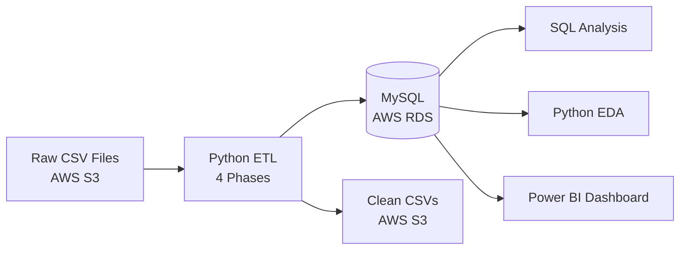

<div align="center">

# 🍴 Golden Fork Bistro: Restaurant Data Analytics

### End-to-end data project: Raw data → ETL → Cloud database → SQL → Python EDA → Power BI


Project Summary 

</div>

---

## 📑 Table of Contents

- [Project Overview](#project-overview)
- [Business Problem](#business-problem)
- [Architecture](#architecture)
- [Dataset](#dataset)
- [ETL Pipeline](#etl-pipeline)
- [SQL Analysis](#sql-analysis)
- [Python EDA](#python-eda)
- [Power BI Dashboard](#power-bi-dashboard)
- [Key Insights](#key-insights)
- [Repository Structure](#repository-structure)
- [Tech Stack](#tech-stack)
- [How to Run](#how-to-run)
- [Skills Demonstrated](#skills-demonstrated)
- [Author](#author)

---

## 🎯 Project Overview

**Golden Fork Bistro** is a fictional multi-city restaurant chain. This project follows the full journey of its data: messy raw files are cleaned by an automated **ETL pipeline**, stored in a **cloud database**, analysed with **SQL** and **Python**, and presented in an interactive **8-page Power BI dashboard**.

> ⚠️ All data is **sample data** created for learning and portfolio purposes. No real customer data is used.

| | |
|---|---|
| **Domain** | Restaurant and Food Delivery |
| **Data** | 8 related tables |
| **Pipeline** | Python ETL with 4 cleaning phases |
| **Cloud** | AWS S3 and AWS RDS |
| **Output** | Clean database, EDA charts, 8-page Power BI dashboard |

---

## ❓ Business Problem

A restaurant chain collects data from many outlets, but raw data is messy: duplicate IDs, wrong dates, inconsistent spellings, invalid promo usage and unrealistic delivery times. Decisions made on bad data are bad decisions.

**This project answers:**
- Which categories and menu items drive revenue and profit?
- How do outlets, cities and customer segments perform?
- Are promotions actually working?
- How efficient are delivery operations?
- What do customers think about food, service and ambience?

---

## 🏗️ Architecture



📄 Detailed design documents (HLA and HLD) are in the [`docs`](docs/) folder.

---

## 🗂️ Dataset

| Table | Description |
|-------|-------------|
| `customers` | Customer profile, city, registration date, lifetime value, loyalty tier |
| `orders` | Orders with date, type, payment method, promo, total and final amount |
| `order_items` | Items inside each order with quantity, price and subtotal |
| `menu_items` | Menu with category, price, cost price, calories, launch date |
| `outlets` | Branches with city, type, seating capacity, opened date |
| `promotions` | Promo codes, type, discount, validity and usage count |
| `delivery` | Delivery partner, assign/pickup/delivery time, distance, duration |
| `feedback` | Food, service and ambience ratings with comments |

**Relationships:** `orders` link to `customers`, `outlets` and `promotions`. `order_items` link to `orders` and `menu_items`. `delivery` and `feedback` link to `orders`.

---

## ⚙️ ETL Pipeline

The whole pipeline is a single script: [`etl-pipeline/master_etl.py`](etl-pipeline/master_etl.py)

**Extract → Transform → Load**

### 📥 Extract
Reads the 8 raw CSV files from AWS S3 and standardises column names.

### 🔧 Transform (4 phases)

| Phase | Goal | What happens |
|-------|------|--------------|
| **1. Standardize** | Consistent structure | Clean primary and foreign keys, remove duplicates and orphan rows, parse 12+ date formats, fix city and payment spellings, normalise ratings |
| **2. Clean Columns** | Clean every table | Fix text case, convert prices to numbers, **mask emails and phones**, fill missing values with "Unknown" or "Not Mention" |
| **3. Business Logic** | Trustworthy numbers | Recalculate quantity, subtotal and order total, validate promo codes, calculate discount and final amount, compute lifetime value and loyalty tier |
| **4. Date and Time Logic** | Realistic timelines | Fix impossible dates, recalculate delivery duration, cap outliers, remove delivery rows for dine-in only outlets |

### 📤 Load
- **MySQL on AWS RDS:** tables created with primary and foreign keys.
- **AWS S3:** cleaned CSVs saved back to a processed bucket (also stored in [`cleaned-data`](cleaned-data/)).

### 🧹 Data Cleaning Examples

| Issue | Before | After |
|-------|--------|-------|
| City spelling | `Banglore`, `Bombay`, `new  delhi` | `Bengaluru`, `Mumbai`, `Delhi` |
| Payment method | `cc`, `u.p.i`, `netbanking` | `Credit Card`, `UPI`, `Net Banking` |
| Price | `Rs. 1,250` | `1250` |
| Rating | `6`, `0`, `-4` | `5`, missing, `4` |
| Order type | `Divry` | `Delivery` |
| Email (privacy) | `rahul123@gmail.com` | `ra***123@gmail.com` |
| Phone (privacy) | `9876543210` | `98******10` |

### 🎟️ Promo Validation
Every order is checked against its promo rules and gets a status:
`No promo` · `Invalid Promo` · `Invalid Week Type` · `Expire Promo` · `Below Min Order` · `Buy 1 Get 1` · `Free Delivery` · `Cashback` · `Flat Discount` · `Percentage used`

### 🏅 Loyalty Tiers

| Tier | Lifetime Value |
|------|----------------|
| 🥇 Platinum | ₹15,000 and above |
| 🥈 Gold | ₹5,000 to ₹14,999 |
| 🥉 Silver | ₹1,000 to ₹4,999 |
| Bronze | Below ₹1,000 |

### 🔒 Security and Privacy
- Customer emails and phone numbers are **masked** in the cleaned data.
- Credentials are stored in a `.env` file, which is **excluded from GitHub** using `.gitignore`.
- `.env.example` shows the required variables without real values.

---

## 🧮 SQL Analysis

SQL queries on the cleaned MySQL database, answering business questions on sales, customers, promotions and delivery.

📁 [`sql-analysis`](sql-analysis/)

---

## 🔍 Python EDA

Exploratory Data Analysis in Jupyter using Pandas and visualisation libraries. Outputs are organised by dashboard page.

📁 Notebooks: [`eda`](eda/)
📁 Outputs: [`eda-output`](eda-output/)

| Output Folder | Covers |
|---------------|--------|
| `overview_output` | Business overview |
| `executive_highlight_output` | Executive KPIs |
| `revenue_analysis_output` | Revenue trends |
| `marketing_performance_output` | Promotions and campaigns |
| `operational_excellence_output` | Outlet operations |
| `logistics_delivery_output` | Delivery performance |
| `product_insights_output` | Menu and product analysis |

---

## 📊 Power BI Dashboard

An interactive **8-page dashboard** with a left navigation menu.

| # | Page | Purpose |
|---|------|---------|
| 1 | **Home** | Landing page and navigation |
| 2 | **Overview** | High-level business summary |
| 3 | **Executive Highlight** | Key KPIs for leadership |
| 4 | **Revenue Analysis** | Revenue trends and breakdowns |
| 5 | **Marketing Performance** | Promotion and campaign results |
| 6 | **Operational Excellence** | Outlet and operations metrics |
| 7 | **Logistics & Delivery** | Delivery time, distance and partners |
| 8 | **Product Insights** | Menu profitability and top items |

### Dashboard Preview


📥 **Download the `.pbix` file:** [Google Drive link]([PASTE-YOUR-LINK-HERE](https://drive.google.com/file/d/1kbE6YT_lKrLlNrI_Zr0UNeA60m0i3KrT/view?usp=drive_link))
*(The file is too large for GitHub, so it is shared through Google Drive.)*

---

## 💡 Key Insights

From the **Product Insights** page:

- 🍛 **Main Course** is the highest revenue category (about ₹19.87M).
- 🍮 **Desserts** have the highest profit margin at **59.13%**.
- ⭐ **Gajar Ka Halwa** is the most profitable item.
- 🌯 **Egg Roll** is the best-selling item.
- 📈 The average profit margin across the menu is **56.51%**, across **54 menu items**.
- 💼 **Recommendation:** bundle high-margin items (like Gajar Ka Halwa) with high-traffic main courses to raise profit per order.

---

## 📁 Repository Structure

```
golden-fork-bistro-analytics/
│
├── data/
│   └── raw/                  # Original uncleaned CSV files
├── cleaned-data/             # Final cleaned CSV files
├── etl-pipeline/
│   └── master_etl.py         # Complete ETL script
├── sql-analysis/             # SQL queries
├── eda/                      # Python EDA notebooks
├── eda-output/               # EDA outputs, one folder per dashboard page
├── power-bi-dashboard/       # Dashboard files and documentation
├── docs/                     # HLA and HLD documents
├── images/                   # Screenshots and diagrams
├── .gitignore
└── README.md
```

---

## 🧰 Tech Stack

| Category | Tools |
|----------|-------|
| **Language** | Python, SQL |
| **Data Processing** | Pandas, NumPy |
| **Database** | MySQL, SQLAlchemy |
| **Cloud** | AWS S3, AWS RDS, Boto3 |
| **Analysis** | Jupyter Notebook, SQL |
| **Visualisation** | Power BI |
| **Version Control** | Git, GitHub |
| **Configuration** | python-dotenv |

---

## 🚀 How to Run

**1. Clone the repository**
```bash
git clone https://github.com/PushpkarRoy/golden-fork-bistro-analytics.git
cd golden-fork-bistro-analytics
```

**2. Install the libraries**
```bash
pip install -r etl-pipeline/requirements.txt
```

**3. Explore the project outputs**

| Want to see... | Go to |
|----------------|-------|
| The raw messy data | [`data/raw`](data/raw/) |
| The cleaned data | [`cleaned-data`](cleaned-data/) |
| The SQL queries | [`sql-analysis`](sql-analysis/) |
| The Python analysis and charts | [`eda`](eda/) and [`eda-output`](eda-output/) |
| The dashboard preview | [`images`](images/) |
| The design documents (HLA and HLD) | [`docs`](docs/) |

**4. Configure AWS access**
```bash
aws configure
```

**5. Run the pipeline**
```bash
python etl-pipeline/master_etl.py
```

---

## 🏆 Skills Demonstrated

- Designing and building an **end-to-end ETL pipeline** from scratch
- **Data cleaning and validation:** keys, dates, categories, outliers
- Implementing **business rules in code:** promotions, loyalty tiers, lifetime value
- **Data privacy:** masking sensitive customer information
- **Cloud data engineering** with AWS S3 and RDS
- **Relational database design** with primary and foreign keys
- **SQL analysis** and **Python EDA**
- **Dashboard design and storytelling** in Power BI
- **Professional documentation:** HLA, HLD and README

---

## 👨‍💻 Author

**Pushpkar Roy**

[](https://github.com/PushpkarRoy)
[](https://www.linkedin.com/in/pushpkar-roy/)

---

<div align="center">

⭐ If you found this project useful, please give it a star!

</div>
